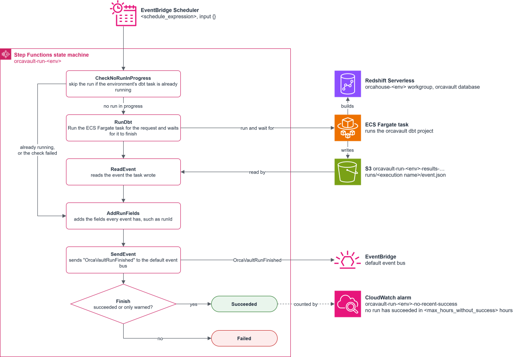

# OrcaVault daily run

Builds the [umccr/orcavault](https://github.com/umccr/orcavault) dbt project on
Redshift Serverless once a day, in dev and prod.



## Environments

Dev and prod each have their own run, which builds the orcavault database in
their own workgroup, `orcahouse-dev` or `orcahouse-prod`. Both are in the
warehouse account, and resources created by an environment have the environment
name, to avoid conflicts.

| Directory                               | Purpose                                                                                | Applied         |
| --------------------------------------- | -------------------------------------------------------------------------------------- | --------------- |
| `account-wide`                          | Creates the ECR repository, `orcavault-run-dbt`                                        | once            |
| `environments/dev`, `environments/prod` | The run infrastructure, with a schedule, state machine, task, roles, results and alarm | per environment |
| `modules/orcavault-run`                 | The common module that each environment uses                                           |                 |
| `docker`                                | The python wrapper that performs `dbt build`                                           |                 |
| `docs`                                  | The [initial load](docs/initial-load.md) of a new environment, and the diagram         |                 |

There is a single image for both dev and prod to ensure that both use the same
build. The orcavault git ref controls which image is used for a deployment.

Within a single run, dbt orders itself, and knows how to apply models correctly.
So the Step Functions deployment represents an automation wrapper that can
schedule and orchestrate the run. The wrapper is a Python script that checks
inputs and returns well formatted outputs, which is primarily useful for
downstream notifications or services. Fargate is used as the executor for the
dbt run to avoid any time limits associated with a Lambda function, which would
be too short.

## What a run does

Each run effectively runs `dbt build` which updates orcavault models. Tests are
run as part of this, with different kinds of outcomes representing success or
failure. OrcaVault's incremental models assume runs don't overlap, so the Step
Functions checks that no other executions are currently running. The run is
configured to start at 03:00 Melbourne time. That is after the OrcaGlue TSA jobs
(13:10 UTC) and the OrcaBus Glue crawlers (15:00 UTC).

### Outcomes

Each run ends with one of these outcomes, i.e. the `outcome` field of the event:

| Outcome     | Meaning                                                                                                 | Execution |
| ----------- | ------------------------------------------------------------------------------------------------------- | --------- |
| `succeeded` | Everything built and every test passed.                                                                 | succeeds  |
| `warned`    | Only warn-severity tests failed. Models were still applied.                                             | succeeds  |
| `failed`    | A model didn't build, or an error-severity test or a hook failed.                                       | fails     |
| `error`     | dbt couldn't run, the request was invalid or selected nothing, or the run was stopped or never started. | fails     |
| `skipped`   | Another run was still going, so this one didn't start.                                                  | fails     |

A succeeded execution's output is the event's `detail`. A failed execution has
no output. Its error is the outcome, and its cause is the event's `error`, or
else the failed nodes, so the Step Functions console shows what happened.

### When some models fail

If some models fail, the run is reported as failed, and everything that could
load does load.

- Models that succeeded stay loaded. Each model commits on its own.
- A failed model skips only the models that depend on it. Unrelated models still
  build, unless the run was started with `--fail-fast`, which you can request
  with `{"args": "build --fail-fast"}` as the execution's input, see
  [Requests](#requests).

A failed run is not retried automatically. Whatever failed would most likely
fail again, and the next daily run covers it. Once the cause is fixed, run it
again by hand, see
[Running again after a failure](#running-again-after-a-failure). Failures to
start the task, such as no Fargate capacity, are retried automatically.

## Initial load

A new environment is set up and loaded once, before the daily schedule takes
over. This creates the image repository, applies the environment, grants the
task's database user, and loads the legacy sources. This should always be
followed for a deployment in a new environment, see
[docs/initial-load.md](docs/initial-load.md).

## Operating

Each environment is run on its own. The `terraform` commands here are run in its
directory, `environments/dev` or `environments/prod`. Its outputs are under
`orcavault_run`.

- **Start a run** with the `start_run_command` output, or from the Step
  Functions console with input `{}`. Leave the execution name to Step Functions.
- **Pause the schedule** with `-var schedule_enabled=false`.
- **Stop a run** by stopping its task, from the ECS console or the execution's
  `RunDbt` step. The runner tells dbt to cancel its queries. If dbt hasn't
  exited in time ECS kills the task, and the state machine sends the run event.
  A run that reaches `run_timeout_hours` is stopped the same way. Stopping the
  execution instead also stops the task, but ends the execution before it sends
  the run event.
- **Logs can be read** with the `logs_command` output, or from the `logsUrl` in
  the run's event.
- **Release a new version** by setting the new ref as `orcavault_release_ref` in
  `environments/dev/release.auto.tfvars`,
  [building and pushing its image](#building-an-image), and applying dev. Once
  successful, set prod to the same ref and apply it. Commit each change, so that
  the files consistently document the environment.

### Building an image

`orcavault_release_ref` is the orcavault tag or commit the image is built from,
and its ECR tag. Each environment sets it in its `release.auto.tfvars`. Tags are
immutable. Prefer to pin a release tag or commit.

First, update the `release.auto.tfvars`, with, for example, the latest ref:

```bash
git ls-remote https://github.com/umccr/orcavault.git refs/heads/main | cut -f1
```

Then build and push it from this directory, which takes whatever ref is inside
`release.auto.tfvars` currently:

```bash
REF=$(sed -n 's/^orcavault_release_ref *= *"\([^"]*\)".*/\1/p' environments/dev/release.auto.tfvars)
REPO=$(terraform -chdir=account-wide output -raw ecr_repository_url)
aws ecr get-login-password | docker login --username AWS --password-stdin "${REPO%%/*}"
docker buildx build --platform linux/arm64 --provenance=false --build-arg "ORCAVAULT_REF=$REF" -t "$REPO:$REF" --push docker/
```

The image holds orcavault at that ref with the dbt version it pins, and the
runner from `docker/runner` with the versions in its `uv.lock`. The build runs.
Both environments run the same image, so push each ref once.

### Requests

The execution input is the dbt arguments for the run. The scheduled run's `{}`
is `dbt build`. Arguments can be specified in the input:

```json
{
  "args": [
    "build",
    "--select",
    "path:models/dcl/raw_vault/library+",
    "--vars",
    "{\"reread_from\": \"2026-09-01\"}"
  ]
}
```

`args` can also be a string, split as a shell would, such as
`{"args": "build --select +lims --full-refresh"}` or
`{"args": "build --selector orcabus"}`.

The command must be `build`, `run`, `test`, `seed` or `snapshot`. This runs the
Step Functions via ECS as the runner, tracks outcomes. Other commands can be run
manually, however this has no outcome tracking. See
[Running the image by hand](#running-the-image-by-hand). If you need to run
multiple commands, they should be executed in sequence with a new Step Functions
invocation.

### Running again after a failure

Once the cause is fixed, start the same request again, which for a scheduled run
is `{}`. dbt builds everything again, and the models skip the rows they already
have. To rebuild only a part, such as the model that failed and what depends on
it, select it using `{"args": "build --select lims+"}`.

Run again with a new execution rather than a
[redrive](https://docs.aws.amazon.com/step-functions/latest/dg/redrive-executions.html).

### The run event

Every execution ends by sending this event to the default event bus, except one
that was stopped, see [Operating](#operating). Notifications, and anything else
that reacts to a run, should use it.

The runner writes how the run went to `runs/<execution name>/event.json` in the
results bucket. The state machine reads it, adds the fields every run event has,
and sends it to EventBridge. Even if the runner failed to write an event, the
state machine will properly format what gets sent to EventBridge with an `error`
field.

An example of an event going to EventBridge:

```json
{
  "source": "orcahouse.orcavault",
  "detail-type": "OrcaVaultRunFinished",
  "detail": {
    "environment": "prod",
    "outcome": "failed",
    "error": null,
    "runId": "4b8e1f3a-…",
    "modelsSucceeded": 140,
    "modelsFailed": 0,
    "modelsSkipped": 3,
    "testsPassed": 512,
    "testsWarned": 1,
    "testsFailed": 1,
    "failedNodes": "unique_hub_library_library_hk",
    "warnedNodes": "accepted_values_lims_type",
    "orcavaultRef": "v1.2.3",
    "durationMinutes": 42,
    "logsUrl": "https://ap-southeast-2.console.aws.amazon.com/cloudwatch/home?…",
    "executionUrl": "https://ap-southeast-2.console.aws.amazon.com/states/home?…"
  }
}
```

- The detail is flat, and every field is always there.
- `environment` is `dev` or `prod`.
- `error` says why the outcome is `error` or `skipped`, such as
  `The run was stopped`, and is null otherwise. Messages are formatted without
  quotes or backslashes to that an input transformer can put it in a JSON
  string.
- `failedNodes` and `warnedNodes` have up to 10 nodes.
- `durationMinutes` is from when the execution started.
- `logsUrl` is the task's log stream. It's null when the task never started, and
  when the run timed out.

### The run's manifest

After every run, the runner also writes dbt's `target/manifest.json` to
`state/manifest.json` in the results bucket based on the `manifest_uri`. It
describes the models the environment builds and where they are, and is replaced
by each run. This mechanism is what the OrcaVault personal schemas are based on,
see [README_DEV.md](https://github.com/umccr/orcavault/blob/main/README_DEV.md).

### Running the image by hand

If you run the image manually, nothing will be recorded in the Step Functions
automation. This is what `debug_command` does. For example, locally, with AWS
credentials that can connect to Redshift:

```bash
docker run --rm -e AWS_PROFILE -v ~/.aws:/home/dbt/.aws:ro \
  -e ORCAVAULT_REDSHIFT_HOST=<workgroup endpoint> \
  -e ORCAVAULT_RUN_REQUEST='{"args": "test --select mart"}' \
  "$REPO:$REF"
```

Without `ORCAVAULT_RESULTS_BUCKET`, the event stays in the container, under
`ORCAVAULT_RESULTS_DIR`, and the manifest isn't written.

### Local development

The runner uses [uv](https://docs.astral.sh/uv/getting-started/installation/)
for development. To run the tests:

```bash
cd docker/runner
uv run pytest
```

Its code is linted and formatted with ruff, which CI checks:

```bash
uv run ruff check --fix
uv run ruff format
```

The Terraform tests are the module:

```bash
cd modules/orcavault-run
terraform init -backend=false
terraform test
```

## Other considerations

- **Query time limit.** Each workgroup stops any query that runs longer than 900
  seconds (`max_query_execution_time`).
- **Monthly compute limit.** Each workgroup is deactivated once it uses 120
  RPU-hours in a month. Every run, and everything else on the workgroup, counts
  towards it, including this runner.
- **Image archiving.** An image that no environment has pulled for 90 days is
  archived, and deleted a year later, see `account-wide/main.tf`.
- **Network.** The task runs in the private subnets of `UomPrimaryVpc`, without
  a public IP. It needs to reach ECR and CloudWatch Logs to start, the
  `redshift-serverless` API to get credentials, the workgroup on port 5439, and
  S3 to write its event and manifest. These need VPC endpoints or a NAT gateway.
  `debug_command` can be used to quickly check.
